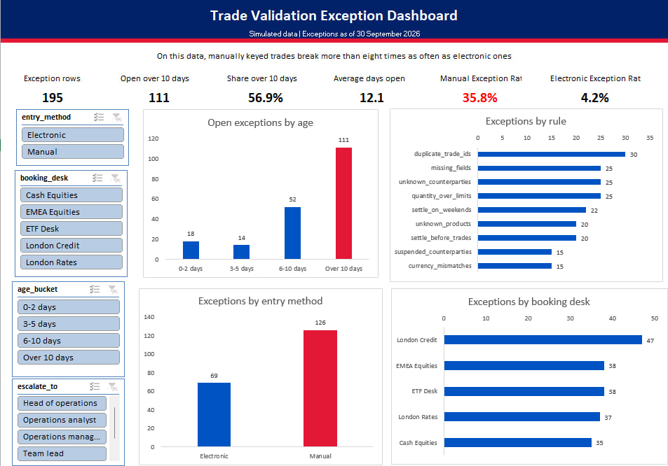

# Trade Validation and Exception Tracker

A small operations project that checks simulated trades before settlement, flags every exception, ages each one and shows the results on an Excel dashboard.

> **Note:** the data used in this project is synthetic. No real trades, firms, clients or people appear in it. This is an independent learning project and is not affiliated with any bank.



## The idea

In the trade lifecycle, a mistake costs more the later it is found. This project asks a simple question. If every trade is checked against reference data as soon as it is booked, how many errors can be caught before settlement, and how long do the exceptions stay open?

## What it does

1. Loads 2,000 simulated trades plus counterparty and product reference tables.
2. Runs nine validation rules in Python (pandas).
3. Ages each exception as of 30 September 2026 and assigns an escalation owner.
4. Exports the results to an Excel dashboard with PivotTables and slicers.
5. Repeats five of the checks in SQL (SQLite) to confirm the counts.

## The nine rules

| Rule | What it catches |
|---|---|
| Missing field | A blank counterparty, quantity, price or settlement date |
| Unknown counterparty | A counterparty ID that is not in the reference table |
| Unknown product | A product ID that is not in the reference table |
| Settles before trade | A settlement date earlier than the trade date |
| Settles on weekend | A settlement date on a Saturday or Sunday |
| Quantity over limit | A quantity above the product's maximum |
| Suspended counterparty | A trade with a counterparty marked Suspended |
| Currency mismatch | A trade currency that differs from the product's currency |
| Duplicate trade ID | The same trade ID appearing more than once |

## Results on the simulated data

- 180 of the 2,000 trades had at least one error. The exception list has 195 rows because 15 trade IDs appear twice.
- Duplicate trade IDs were the most common rule hit (30 rows). Missing fields, unknown counterparties and oversized quantities followed with 25 each.
- 111 of the 195 exception rows (57%) had been open for more than 10 days.
- Manually keyed trades had an exception rate of 35.8%, against 4.2% for electronic trades. I built that gap into the data, so it is not a finding about real banks. It shows what the tracker would surface if real data looked like this.

## Escalation rule (my own assumption)

| Days open | Escalate to |
|---|---|
| 0 to 2 | Operations analyst |
| 3 to 5 | Team lead |
| 6 to 10 | Operations manager |
| Over 10 | Head of operations |

## Repository structure

```text
data/        simulated trade, counterparty and product tables
notebooks/   the Python notebook with all rules and summaries
sql/         the SQL versions of five checks
dashboard/   the Excel dashboard, a PDF export and a preview image
docs/        a one-page write-up
```

## How to run it

1. Open `notebooks/trade_validation_tracker.ipynb` in Google Colab.
2. Upload `data/simulated_trades.xlsx` using the folder icon on the left.
3. Click Runtime, then Run all.

## Assumptions and limits

- Settlement is two business days after the trade date. Weekends are treated as non-settlement days. Public holidays are not.
- The age bands and escalation owners are my own choices, not any bank's policy.
- The data is simulated, so the results show how the tool works and not how a real bank performs.

## How this was built

The synthetic dataset was generated with the help of an AI assistant, with known errors planted in it so the rules could be tested.

## Author

Boluwatife Ayesa | [LinkedIn](https://www.linkedin.com/in/boluwatife-ayesa/)
